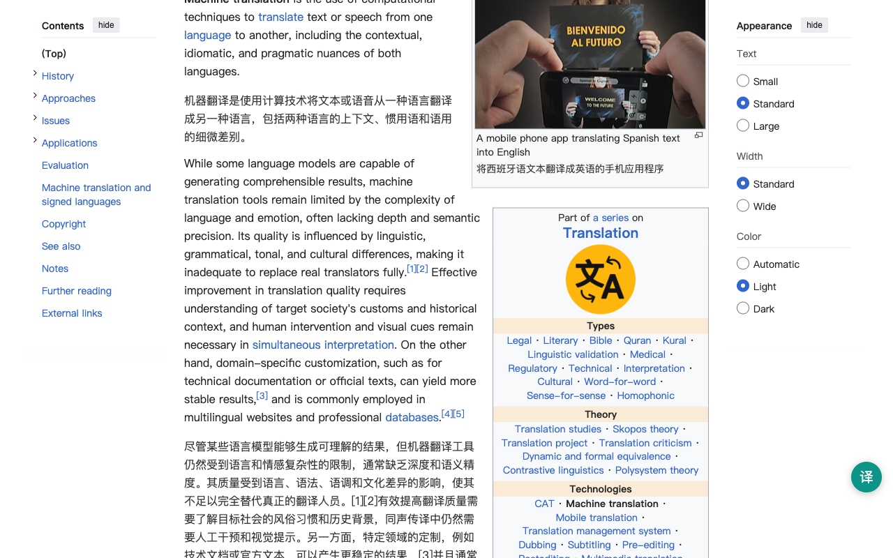

# OpenImmersive Translator

[](https://github.com/OpenImmersive/OpenImmersive-Translator/actions/workflows/ci.yml)
[](LICENSE)

**OpenImmersive Translator** ([openimmersive.ai](https://openimmersive.ai)) is an open-source browser extension for Chrome, Firefox and Edge that shows each paragraph of a web page followed by its translation. It is an open-source alternative to Immersive Translate: the Google, Microsoft and MyMemory engines are free and need no account, and with your own DeepL, OpenAI or DeepSeek key, requests go from your browser straight to that provider.



## About This Project

This project started from a simple need: many friends around me rely on immersive translation tools in their daily work and study, but they also care deeply about data security and privacy.

Since some popular immersive translation tools are not open source, it can be difficult for users to fully understand how their data is processed. To address this concern, I decided to build and open-source an AI-native translation project in my spare time.

The goal of this project is to provide a privacy-focused translation experience that is simple, transparent, and accessible. It removes unnecessary complex settings and is designed especially for users with little or no technical background.

This project focuses on:

* Data security and privacy protection
* Open-source transparency
* AI-native translation experience
* Simple setup and easy daily use
* Accessibility for non-technical users

The vision is to make AI-powered translation more trustworthy, easier to use, and safer for everyone.

## Features

- **Bilingual, in place** — side-by-side translation on the page you are reading. No copy-paste, no uploading your content to someone else's website. Toggle with `Alt+T`.
- **Privacy by architecture** — with the free engines or your own API key, translation requests go directly from your browser to the engine you choose, with no server of ours in between, and the extension sends no telemetry ([privacy policy](PRIVACY.md)). The optional Standard and Premium AI tiers are the exception: they send the text to openimmersive.ai, need an openimmersive.ai account and spend credits (see the [website privacy policy](https://openimmersive.ai/privacy)).
- **Sensitive-data masking (Beta)** — optional, off by default. Emails, phone numbers, bank card numbers (Luhn-validated), national ID numbers, and API keys (`sk-…`, `ghp_…`, `AKIA…`, JWT, …) are detected **locally**, replaced with placeholders before the text is sent to any engine, and restored locally afterwards. The originals never leave your browser. See [`sensitive-mask.js`](sensitive-mask.js).
- **Transparent engines, BYOK** — free out of the box with no account (Google, Microsoft, MyMemory), LibreTranslate on a self-hosted instance; bring your own key for DeepL / OpenAI / DeepSeek. Keys are stored in `storage.local` only.
- **199 target languages** with the default Google engine (other engines cover fewer): the 20 most-used in the popup, all 199 in Settings. Chrome and Edge (MV3 service worker) and Firefox (MV3 event page) supported.
- **File translation** — translate .srt, .ass, .html, .txt and .md files from the options page. Only the text is translated; subtitle timing, HTML tags and Markdown code blocks are kept.
- **Free engines back each other up** — if Google is rate-limited, the extension tries Microsoft, then MyMemory, so a page does not stall without your own API key.
- **Optional AI tiers** — Standard and Premium give context-aware AI translation through an openimmersive.ai account (credits). Everything else works without an account.

## The website

[openimmersive.ai](https://openimmersive.ai) also translates files: PDF with the layout kept, EPUB, PowerPoint, Word, Excel and SRT. Only this extension is open source; the website, including the Standard and Premium AI tiers, is a hosted service.

## Install

**From the store:** [Chrome Web Store](https://chromewebstore.google.com/detail/klahcooagpabkjnmhlelekijcjanhipb) · [Firefox Add-ons](https://addons.mozilla.org/firefox/addon/open-immersive-translator/) · [Microsoft Edge Add-ons](https://microsoftedge.microsoft.com/addons/detail/libcfiffjapclboglfkhdbnledcjmape)

**From source (Chrome / Edge):**

1. Clone this repository
2. Open `chrome://extensions`, enable *Developer mode*
3. *Load unpacked* → select the repository folder

**From source (Firefox):** in `manifest.json`, replace the `background` block with `{"scripts": ["sensitive-mask.js", "background.js"]}`, then load via `about:debugging` → *Load Temporary Add-on*.

## How sensitive-data masking works

```
"Contact admin@example.com or call 13812345678"
        │  local detection (regex + checksums)
        ▼
"Contact __PII_EMAIL_1__ or call __PII_PHONE_1__"   →  translation engine
        │  translated text returns
        ▼
"联系 admin@example.com 或致电 13812345678"            ←  local restore
```

Detection is precision-first: card numbers must pass a Luhn check, Chinese national IDs must pass the mod-11 checksum, so financial figures, years, and thousand-separated numbers in ordinary text are never touched. Restore tolerates the common ways engines mangle placeholders (case changes, inserted spaces, dropped trailing underscores). Enable it in the extension options page.

## Development

```bash
npm install
npm test        # jest — unit + integration (masking round-trips through translate())
```

No build step: the extension loads directly from source. `background.js` routes all engines through a single `translate()` entry point; `sensitive-mask.js` is a dependency-free UMD module.

If OpenImmersive Translator is useful to you, a ⭐ on this repository helps other people find it.

## License

This project is licensed under the GNU Affero General Public License v3.0 only (AGPL-3.0-only).

You may use, study, modify, and distribute this project under the terms of the AGPL-3.0-only license.

If you modify this project, distribute it, or make it available as part of a network service, you must make the corresponding source code available under the same license.

For commercial closed-source use, please contact the project maintainer for a separate commercial license.
